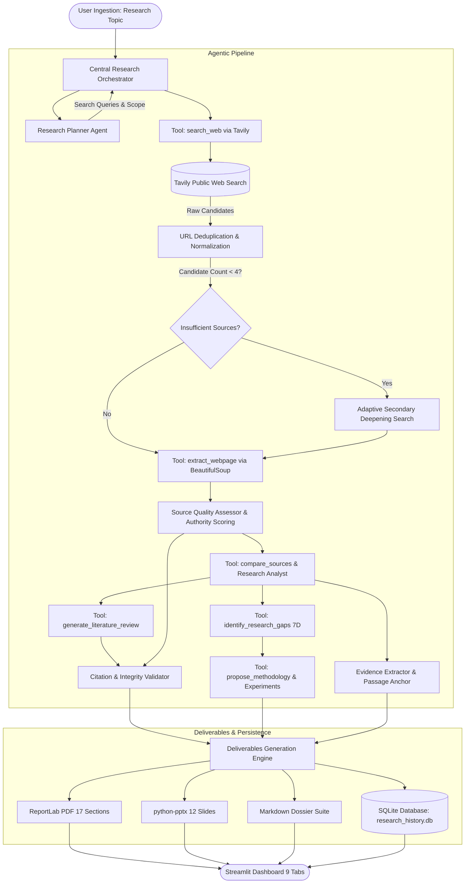

# Klein AI — ResearchMate AI: System Architecture Specification

## 1. Architectural Overview

ResearchMate AI is designed as a **decoupled, multi-agent autonomous system**. Rather than relying on a monolithic prompt or an opaque multi-layer framework, it coordinates modular Python agents through a centralized **Research Orchestrator** and a typed **Tool Registry**.



---

## 2. Key Differences: Conversational Chatbot vs. Autonomous Research Agent

| Capability | Standard Conversational Chatbot | Klein AI — ResearchMate AI |
|---|---|---|
| **Web Research** | None or single ungrounded query | Multi-query, multi-angle search via Tavily with adaptive deepening |
| **Evidence Grounding** | Generates plausible-sounding text from memory | Anchors every claim to extracted source quotes with confidence ratings |
| **Citations & References** | Frequent hallucination of non-existent papers/DOIs | 100% verified against collected URLs; audits missing metadata |
| **Tool Execution** | Single prompt-response loop | Formal `ToolRegistry` with typed execution, telemetry, and error boundaries |
| **Source Credibility** | Treats all text equally | Classifies source type (ArXiv, IEEE, NIST, Blog) and scores authority |
| **Research Gaps** | Generic suggestions | 7-dimension structured analysis (Title, Impact, Sources, RQ, Feasibility) |
| **Methodology** | High-level summary | Complete research design, hypotheses ($H_1-H_3$), variables, and proposed experiments |
| **Output Deliverables** | Plain chat response | 17-section PDF (with clickable links), 12-slide PowerPoint, and Markdown files |
| **Session Persistence** | Lost on browser refresh | SQLite persistence with automatic state recovery |

---

## 3. Data Structures & Schemas

### Evidence Item Schema
```json
{
  "citation_index": 1,
  "claim": "Machine learning intrusion detection models achieved 98.4% accuracy against ransomware attacks.",
  "source_title": "AI in Healthcare Cybersecurity",
  "source_url": "https://ncbi.nlm.nih.gov/article/1",
  "evidence": "Observed 98.4% detection recall across simulated attack vectors.",
  "publication_date": "2024",
  "source_type": "Biomedical Repository (PubMed/NIH)",
  "confidence": "Supported"
}
```

### 7-Dimension Research Gap Schema
```json
{
  "gap_id": "GAP-01",
  "gap_title": "Scalability and Latency Degradation Under Non-Stationary Workloads",
  "explanation": "Current implementations suffer significant throughput collapse and unpredictable latency under bursty distributions.",
  "supporting_sources": ["[1] Author et al.", "[3] Survey on Architecture"],
  "why_it_matters": "Prevents mission-critical edge deployments and causes SLA violations.",
  "suggested_research_question": "How can dynamic context routing maintain sub-50ms latency under stochastic loads?",
  "possible_methodology": "Factorial stress-testing using Poisson arrival rate simulations.",
  "feasibility": "High",
  "disclaimer": "Potential gap identified within collected literature; not proof of global novelty."
}
```

### Proposed Experiment Schema
```json
{
  "experiment_id": "EXP-01",
  "name": "Throughput and Latency Scalability Stress-Test",
  "hypothesis": "Decoupled architecture reduces P99 latency by >= 35% without significant fidelity loss (p < 0.05).",
  "target_datasets": "Standardized academic benchmarking partitions and synthetic high-concurrency request streams.",
  "baseline_models": "Current monolithic state-of-the-art implementations.",
  "evaluation_metrics": "P99 Latency (ms), Queries Per Second (QPS), Peak VRAM (GB)",
  "validation_status": "Proposed Protocol (Pending Empirical Execution)"
}
```
